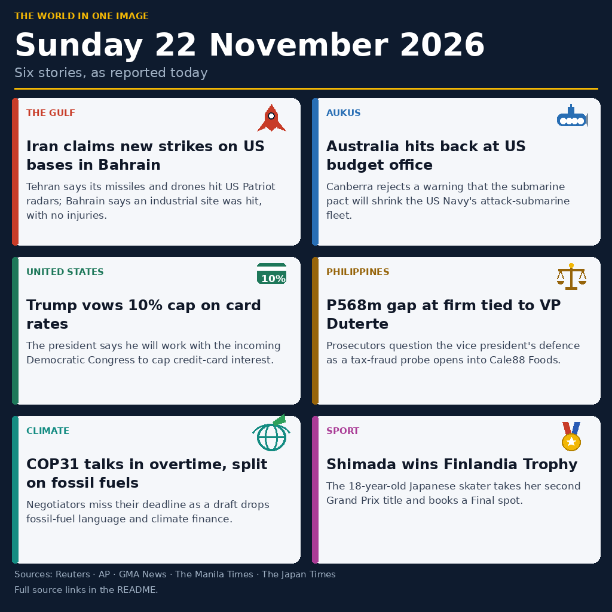

# Sunday 22 November 2026 — The World in One Image

[](https://make.fun/bounty/news-image-20261122)
[](https://make.fun/bounty/news-image-20261122)
[](https://make.fun/bounty/news-image-20261122)

One 1024×1024 infographic summing up the world's news of **Sunday 22 November 2026**, drawn with Pillow and copied to `/output/entry.png` by a standard-library-only Python program. Entry for the [make.fun bounty "Sum up 22 November's world news in one image"](https://make.fun/bounty/news-image-20261122).



## The six stories

**A note on dates.** This contest was built in the first hours of Sunday 22 November (UTC), when the day's own reporting was just beginning. Two stories below were first reported on 22 November itself; the other four happened on Saturday 21 November and were carried in the Sunday 22 November editions — they are described here exactly as reported that Sunday, and the image claims no other date for them.

1. **The Gulf — Iran claims new strikes on US bases in Bahrain.** Iran's Revolutionary Guard says its missiles and drones hit US Patriot radars at the al-Riffa and Awali bases; Bahrain says an Iranian attack hit a civilian industrial facility, causing a fire but no injuries, while its air defences intercepted a number of attacks. First reported 22 November.
   - [GMA News — Bahrain says Iranian attack hits industrial facility](https://www.gmanetwork.com/news/topstories/world/1010356/bahrain-says-iranian-attack-hits-industrial-facility-as-air-defenses-intercept-attacks/story/?top_picks&order=2)
   - [The Tribune — Iran claims missile and drone strikes targeted US Patriot radars at Bahrain bases](https://www.tribuneindia.com/news/world/iran-claims-missile-and-drone-strikes-targeted-us-patriot-air-defence-radars-at-bahrain-bases/)
2. **AUKUS — Australia hits back at the US budget office.** Defence Minister Richard Marles criticises the US Congressional Budget Office over a report saying the AUKUS pact would shrink the US Navy's attack-submarine fleet. First reported 22 November.
   - [Reuters — Australia criticises US Congressional Budget Office over AUKUS comments](https://www.reuters.com/world/asia-pacific/australia-criticises-us-congressional-budget-office-over-aukus-comments-2026-11-22/)
3. **United States — Trump vows a 10% cap on credit-card rates.** President Donald Trump says he will work with the incoming Democratic Congress to cap credit-card interest rates at 10%, reviving a 2024 campaign promise. Said Saturday 21 November; reported in the Sunday editions.
   - [AP via The Manila Times — Trump vows to work with Democrats to cap credit card interest rates at 10%](https://beta.manilatimes.net/2026/11/22/world/trump-vows-to-work-with-democrats-to-cap-credit-card-interest-rates-at-10/2475574)
4. **Philippines — P568m gap at a firm tied to VP Duterte.** House prosecutors flag a discrepancy between Cale88 Foods Corp.'s declared sales and documented bank inflows, opening tax-fraud questions for Vice President Sara Duterte's defence. Reported in the 22 November edition.
   - [The Manila Times — 'Cale88 opens up VP to tax fraud charges'](https://www.manilatimes.net/2026/11/22/podcasts/headlines-cale88-opens-up-vp-to-tax-fraud-charges-november-22-2026/2475474/amp)
5. **Climate — COP31 talks in overtime, split on fossil fuels.** The summit misses its scheduled end as negotiators stay deadlocked over whether the final deal names fossil fuels and over finance for poorer countries. Talks continuing into 22 November.
   - [Reuters — COP31 climate summit risks failure as talks go deep into overtime](https://www.reuters.com/sustainability/cop/cop31-climate-summit-risks-failure-talks-go-deep-into-overtime-2026-11-21/)
6. **Sport — Shimada wins the Finlandia Trophy.** Japan's Mao Shimada, 18, takes her second Grand Prix title of her debut senior season (229.49 points) and books a place in the Grand Prix Final in China. Won Saturday 21 November in Helsinki; reported 22 November.
   - [The Japan Times — Mao Shimada wins Finlandia Trophy to book spot in Grand Prix Final](https://www.japantimes.co.jp/sports/2026/11/22/more-sports/mao-shimada-wins-finland/)

## How it works

- `draw_infographic.py` (build-time only, Pillow) draws `entry.png`: a navy header naming **Sunday 22 November 2026**, six story cards — each with a hand-drawn geometric icon, a headline and a two-line summary — and a sources footer. Re-running it reproduces the same image.
- `main.py` (Python 3.13, standard library only, no network) copies `entry.png` to `$MAKEFUN_OUTPUT_DIR/entry.png`. Running it twice writes byte-identical output.

## Verify locally

```sh
python3 draw_infographic.py          # regenerate entry.png
rm -rf /tmp/out1 /tmp/out2
MAKEFUN_OUTPUT_DIR=/tmp/out1 python3 main.py
MAKEFUN_OUTPUT_DIR=/tmp/out2 python3 main.py
sha256sum /tmp/out1/entry.png /tmp/out2/entry.png entry.png   # all three identical
python3 -c "from PIL import Image; im = Image.open('entry.png'); print(im.size, im.format)"
ls -l entry.png                       # 1024x1024, under 1 MiB
```

## License

MIT — see [LICENSE](LICENSE).
